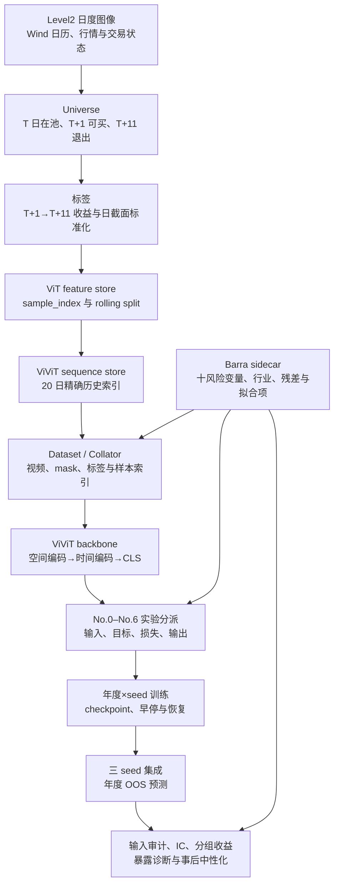
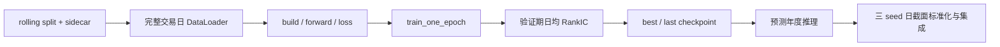

# ViViT：端到端研究流程与源码索引

ViViT 从订单流图像构建股票截面因子，并比较多种 Barra 风险控制方案。本文件只说明工程主流程、跨阶段数据契约和关键源码入口；方案的数学原理见 [Technical_report.md](Technical_report.md)，样本外结果与结论见 [Results.md](Results.md)。

## 1. 研究目标与边界

模型读取股票在 T 日及此前 19 个交易日的 17 通道订单流图像，输出 T 日股票截面排序分数。标签对应 T+1 入场、T+11 离场的未来十交易日收益。Barra 数据在不同实验中可以用于构造标签、约束损失、调节模型、投影输出或事后审计，但任何方案都不能改变共同样本、收益窗口和滚动切分口径。

项目实现范围为 No.0–No.6，全部方案均已有训练与样本外评价结果；研究范围不再扩展新的实验方案。

## 2. 端到端主流程



流程中的三个主轴不能混淆：

- `(trade_date, instrument_id)` 是业务主键；
- `sample_index` 是数组、sidecar 和历史序列的物理行号；
- `raw / effective / published score` 区分模型原始输出、训练损失所见输出和正式发布输出。

## 3. 全局数据契约

| 对象 | 主键或 shape | 必须满足的约束 |
|---|---|---|
| Level2 日文件 | `instrument_ids` 唯一；`pixel_matrices=[N,17,8,8]` | `stock_index` 始终指向原 NPZ 的同一股票 |
| Universe | `(trade_date, instrument_id)` 唯一 | 市场状态缺失时 fail-closed；图片有效性与可交易性分开 |
| 标签 | `(trade_date, instrument_id)` 唯一 | 只对 `in_universe_t & can_enter_t1` 计算，窗口固定为 T+1→T+11 |
| feature store | `sample_index=0..S-1` | features、targets、date_ids 和所有 sidecar 第一维一致 |
| rolling split | 三个 `int64` 索引数组 | train/validation 只含有效标签；prediction 覆盖预测年全部有效特征 |
| history index | `[S,20]` | 同股票精确 `date_id-lag`；缺失为 -1；最后一格等于自身 |
| 模型 batch | `videos=[B,17,20,8,8]`；`frame_mask=[B,20]` | 目标日最后一帧有效；缺帧补零但 mask 保留 |
| Barra sidecar | `styles=[S,10]`；`industry=[S]` | 与 feature store 共用 sample_index；同日精确连接，不跨日填充 |
| 预测 | `(trade_date, instrument_id)` 唯一 | 键集合等于预测年 `feature_valid & in_universe_t` 的 Universe 键 |

防泄漏边界：

```text
max(train.exit_trade_date)      < validation_start_date
max(validation.exit_trade_date) < forecast_start_date
history_date_id                 <= target_date_id
Barra 与行情只按同日股票键精确连接
```

## 4. 数据处理流程

### 4.1 Universe

输入包括 Level2 图像元数据、SSE/SZSE 交易日历、T 日与 T+1 的停牌和涨跌停状态。Universe 保留候选行并分别生成：

- `feature_valid`：图像是否可作为模型特征；
- `in_universe_t`：T 日状态已知、非停牌且非涨跌停；
- `can_enter_t1`：T+1 状态已知、非停牌且非涨跌停；
- `entry_trade_date / exit_trade_date`：股票所属交易所的 T+1/T+11。

合并行情前必须验证“股票×日期”唯一，防止重复键把候选行膨胀成笛卡尔积。正式入口为 [`build_universe`](../ViT/vit_stage02_universe.py#L334)。

### 4.2 标签

[`build_t10_labels`](../ViT/vit_stage03_labels.py#L18) 只对 `in_universe_t & can_enter_t1` 样本计算 T+1→T+11 复权收益，并在每日截面执行 1%/99% 缩尾与 `ddof=0` Z-score。标签缺失不会删除预测样本，而是通过 `label_valid` 控制能否进入训练或验证。

### 4.3 Feature store 与滚动切分

[`build_feature_store`](../ViT/vit_stage04_feature_store.py#L45) 以 `feature_valid & in_universe_t` 构建全局图片数组和连续 `sample_index`。每个通道独立在 8×8 网格内归一化，标签以左连接方式附着。

每个预测年度分别生成 train、validation 和 prediction 索引。历史标签先按 `exit_trade_date` 排除跨越验证或预测边界的日期，再进行日期级 80%/20% 切分；预测索引保留预测年度全部有效图片。

### 4.4 20 日视频序列

[`build_history_indices`](stage01_sequence_data.py#L262) 为每个样本查找同股票、精确 `date_id-lag` 的 20 个位置。缺失历史帧记为 -1，禁止用最近可得图片填充。[`build_sequence_store`](stage01_sequence_data.py#L400) 只落盘历史行号，不复制约 20 倍图片数据。

[`VideoBatchCollator`](stage01_sequence_data.py#L571) 在 worker 中批量读取 memmap，构造 `videos` 和 `frame_mask`；[`make_data_loaders`](stage01_sequence_data.py#L670) 建立基础 DataLoader。

### 4.5 Barra 训练 sidecar

九个 CNE5S 风格与 20 日反转形成十个连续风险变量，行业缺失进入 UNKNOWN 组。所有对象以 feature-store `sample_index` 对齐：

| 产物 | shape | 构建入口 |
|---|---|---|
| `style_exposures.npy`、`style_valid.npy` | `[S,10]` | [`build_style_neutral_store`](stage02_barra_data.py#L1982) |
| `targets_style_residual.npy` | `[S]` | [`residualize_daily_targets`](stage02_barra_data.py#L228) |
| `industry_codes.npy` | `[S]` | [`build_industry_sidecar`](stage02_barra_data.py#L1161) |
| `targets_full_barra_residual.npy` | `[S]` | [`build_full_barra_target_sidecar`](stage02_barra_data.py#L1417) |
| `targets_full_barra_fitted.npy` | `[S]` | [`build_dual_tower_target_sidecar`](stage02_barra_data.py#L1696) |

风险暴露只在当日有效截面标准化；数值缺失填零以便张量运算，同时保留 `style_valid`。详细回归、投影和目标分解推导统一放在技术报告。

## 5. 模型、实验与训练流程

### 5.1 模型输入接口

基础 batch 包含：

| 字段 | shape | 用途 |
|---|---|---|
| `videos` | `[B,17,20,8,8]` | Conv3d 与空间—时间 Transformer 输入 |
| `frame_mask` | `[B,20]` | 标记真实历史帧 |
| `targets` | `[B]` | 基础训练目标 |
| `date_ids` | `[B]` | 完整交易日分组 |
| `sample_indices` | `[B]` | 回连业务键和 sidecar |

No.1–No.6 使用 [`StyleNeutralBatchCollator`](stage06_barra_training.py#L963)，额外提供原始/残差/拟合标签、风险暴露、有效掩码和行业代码。涉及日截面排序、回归或投影的方案必须使用完整交易日 batch。

### 5.2 ViViT 主干

[`OrderFlowViViT`](stage03_model.py#L124) 将 `[B,17,20,8,8]` 视频编码为 `[B,128]` CLS 表征，再由收益头输出 `[B]` 分数。空间—时间结构、Tubelet、padding mask、Pre-LayerNorm 和梯度细节见技术报告；工程接口分别由 [`encode`](stage03_model.py#L262) 和模型级 [`forward`](stage03_model.py#L386) 定义。

### 5.3 实验实现入口

下表只承担源码导航，不重复损失推导或实验结果。

| 方案 | 实现入口 | 工程职责 |
|---|---|---|
| No.0 | [`baseline_loss`](stage04_no0_baseline.py#L11) | 无 Barra 约束的控制组 |
| No.1 | [`neutral_training_loss`](stage04_no1_neutral.py#L11) | Y/X/XY 三种目标与有效分数选择 |
| No.2 | [`r_squared_regularized_loss`](stage04_no2_r2_penalty.py#L11) | 原始分数联合风险解释度惩罚 |
| No.3 | [`AdversarialBarraViViT`](stage04_no3_adversarial.py#L138) | GRL 风格头与行业头 |
| No.4 | [`BarraConditionalViViT`](stage04_no4_gate.py#L115) | Barra 条件化乘法门控 |
| No.5 | [`strict_neutral_output`](stage04_no5_strict_neutral.py#L11) | 训练图内严格投影输出 |
| No.6 | [`BarraDualTowerViViT`](stage04_no6_dual_tower.py#L63) | Alpha/Style 双塔与 Total 分解 |

机器可读实验注册由 [`resolve_experiment`](stage04_experiments.py#L55) 校验。各方案的输入、目标、损失、梯度通道和可识别性统一在技术报告中比较；完成状态和指标只在 Results 中维护。

### 5.4 统一训练后端

[`configure_from_args`](stage06_barra_training.py#L425) 解析并校验实验组合，[`build_training_model`](stage06_barra_training.py#L736) 构造模型，[`forward_training_model`](stage06_barra_training.py#L860) 分派前向路径，[`effective_predictions`](stage06_barra_training.py#L1806) 决定训练和验证实际使用的分数。

年度训练以 year×seed 为任务单元：



单任务入口为 [`train_task`](stage06_barra_training.py#L3145)，年度/种子调度为 [`run_a2`](stage06_barra_training.py#L6556)。后台持久任务由 [`launch_training_job`](stage07_training_jobs.py#L562) 启动，并由 [`training_job_status`](stage07_training_jobs.py#L367) 查询。

### 5.5 样本外评价与事后中性化

评价开始前，[`audit_evaluation_inputs`](stage08_factor_evaluation.py#L1402) 要求预测键与目标 Universe 键完全一致。[`run_oos_backtest`](stage08_factor_evaluation.py#L864) 复用 ViT 评价引擎，生成 IC、五分组收益、相对绩效、换手和回撤。

事后中性化不会覆盖源预测，而是由 [`build_barra_residual_run`](stage09_barra_postprocess.py#L1631) 生成独立派生 run；[`analyze_barra_exposures`](stage09_barra_postprocess.py#L1011) 输出风险相关性和联合回归诊断。

## 6. 主要产物

```text
ViT/data/
├── universe/
├── labels_t10/
├── feature_store/
└── rolling_splits/

ViViT/data/
├── aligned_sequence_store/
├── style_neutral_store/
├── predictions/runs/<run_name>/
└── quality/runs/<run_name>/

ViViT/models/runs/<run_name>/
└── forecast_YYYY/seed_*/
```

关键文件：

- `sample_index.parquet`：业务键与全局物理行号；
- `history_indices.npy`：20 日历史图片行号；
- `a2_training_manifest.json`：训练配置、数据签名与预测列契约；
- `vivit_predictions.YYYY.parquet`：年度样本外预测；
- `factor_evaluation/*.parquet`：IC、组合和风险统计；
- `barra_neutralization/*.parquet`：暴露、相关性、回归和正交审计。

## 7. 关键函数索引

### 7.1 数据底座与序列

| 环节 | 函数 |
|---|---|
| 图片文件发现 | [`list_image_paths`](../ViT/vit_stage02_universe.py#L45) |
| 交易所日历 | [`load_calendars`](../ViT/vit_stage02_universe.py#L87)、[`horizon_dates`](../ViT/vit_stage02_universe.py#L127) |
| 市场状态读取 | [`read_market_status`](../ViT/vit_stage02_universe.py#L228) |
| Universe 构建 | [`build_universe`](../ViT/vit_stage02_universe.py#L334) |
| 标签构建 | [`build_t10_labels`](../ViT/vit_stage03_labels.py#L18) |
| 图片归一化与 feature store | [`normalize_pixels`](../ViT/vit_stage04_feature_store.py#L20)、[`build_feature_store`](../ViT/vit_stage04_feature_store.py#L45) |
| 历史索引与序列 | [`build_history_indices`](stage01_sequence_data.py#L262)、[`build_sequence_store`](stage01_sequence_data.py#L400) |
| 序列审计 | [`validate_history_indices`](stage01_sequence_data.py#L857)、[`audit_split_alignment`](stage01_sequence_data.py#L896) |
| 视频 Collator | [`VideoBatchCollator`](stage01_sequence_data.py#L571) |

### 7.2 Barra 数据与代数

| 环节 | 函数 |
|---|---|
| 股票 ID 转换与反转 | [`instrument_ids_to_assetids`](stage02_market_data.py#L140)、[`_attach_reversal_20d`](stage02_market_data.py#L243) |
| 统一代数接口 | [`standardize_style_exposure`](stage02_barra_algebra.py#L22)、[`residualize_style_target`](stage02_barra_algebra.py#L48)、[`decompose_full_barra_target`](stage02_barra_algebra.py#L70) |
| 风格/完整风险投影 | [`project_style_score`](stage02_barra_algebra.py#L100)、[`project_full_barra_score`](stage02_barra_algebra.py#L123) |
| 联合风险解释度 | [`joint_barra_r_squared`](stage02_barra_algebra.py#L153) |
| 风险 sidecar | [`build_style_neutral_store`](stage02_barra_data.py#L1982)、[`build_industry_sidecar`](stage02_barra_data.py#L1161) |
| 完整残差与双塔标签 | [`build_full_barra_target_sidecar`](stage02_barra_data.py#L1417)、[`build_dual_tower_target_sidecar`](stage02_barra_data.py#L1696) |
| 可微完整投影 | [`project_out_full_barra_torch`](stage02_barra_data.py#L958) |

### 7.3 模型、损失与训练

| 环节 | 函数 |
|---|---|
| ViViT 配置与主干 | [`VivitModelConfig`](stage03_model.py#L12)、[`OrderFlowViViT`](stage03_model.py#L124) |
| 可微排序 | [`sigmoid_soft_rank`](../ViT/vit_stage06_ranking.py#L81)、[`differentiable_rank_ic`](../ViT/vit_stage06_ranking.py#L150) |
| No.0–No.2 损失 | [`baseline_loss`](stage04_no0_baseline.py#L11)、[`neutral_training_loss`](stage04_no1_neutral.py#L11)、[`r_squared_regularized_loss`](stage04_no2_r2_penalty.py#L11) |
| No.3 | [`gradient_reverse`](stage04_no3_adversarial.py#L58)、[`AdversarialBarraViViT`](stage04_no3_adversarial.py#L138) |
| No.4 | [`prepare_conditioning_inputs`](stage04_no4_gate.py#L65)、[`BarraConditionalViViT`](stage04_no4_gate.py#L115) |
| No.5 | [`strict_neutral_output`](stage04_no5_strict_neutral.py#L11) |
| No.6 | [`BarraDualTowerViViT`](stage04_no6_dual_tower.py#L63)、[`dual_tower_training_loss`](stage04_no6_dual_tower.py#L237) |
| 变体模型工厂 | [`build_training_model`](stage06_barra_training.py#L736)、[`forward_training_model`](stage06_barra_training.py#L860) |
| 统一训练与预测 | [`train_one_epoch`](stage06_barra_training.py#L1863)、[`evaluate_model`](stage06_barra_training.py#L2220)、[`predict_model`](stage06_barra_training.py#L2660) |
| 单任务与集成 | [`train_task`](stage06_barra_training.py#L3145)、[`build_ensemble`](stage06_barra_training.py#L3792) |
| 训练调度 | [`run_a2`](stage06_barra_training.py#L6556)、[`launch_training_job`](stage07_training_jobs.py#L562) |

### 7.4 评价与派生因子

| 环节 | 函数 |
|---|---|
| 五分组分配 | [`assign_factor_quantiles`](stage08_factor_evaluation.py#L422) |
| 输入覆盖审计 | [`audit_evaluation_inputs`](stage08_factor_evaluation.py#L1402) |
| 样本外评价 | [`run_oos_backtest`](stage08_factor_evaluation.py#L864) |
| 实验对比 | [`compare_factor_evaluations`](stage08_factor_evaluation.py#L991)、[`compare_prediction_signal_pearson`](stage08_factor_evaluation.py#L1120) |
| 风险暴露分析 | [`analyze_barra_exposures`](stage09_barra_postprocess.py#L1011) |
| 事后中性化 | [`build_barra_residual_run`](stage09_barra_postprocess.py#L1631) |
| Barra 输入审计 | [`audit_barra_inputs`](stage09_barra_postprocess.py#L2110) |

## 8. 审计边界

| 风险 | 控制方式 | 关键证据 |
|---|---|---|
| 行情重复键导致 merge 膨胀 | 合并前验证股票×日期唯一 | [`read_market_status`](../ViT/vit_stage02_universe.py#L228) |
| T 日信号使用不可实现成交价 | 标签固定 T+1 入场 | [`build_t10_labels`](../ViT/vit_stage03_labels.py#L18) |
| 标签跨越验证或预测边界 | 使用 `exit_trade_date` 做两层 purge | [`build_feature_store`](../ViT/vit_stage04_feature_store.py#L45) |
| 历史缺帧被前向填充 | 精确日期槽位，缺失=-1 | [`build_history_indices`](stage01_sequence_data.py#L262) |
| 图片、标签、Barra 错位 | 全链路共享 `sample_index` | [`VideoBatchCollator`](stage01_sequence_data.py#L571) |
| 日截面被拆批 | Barra 变体强制完整交易日 batch | [`make_style_loaders`](stage06_barra_training.py#L1122) |
| 训练与发布分数混淆 | 显式维护 raw/effective/published | [`effective_predictions`](stage06_barra_training.py#L1806) |
| 预测覆盖不完整 | 评价前做键集合全等检查 | [`audit_evaluation_inputs`](stage08_factor_evaluation.py#L1402) |

这份 README 是工程流程和源码定位的唯一入口。方案原理不在此重复，实验指标也不在此维护。
