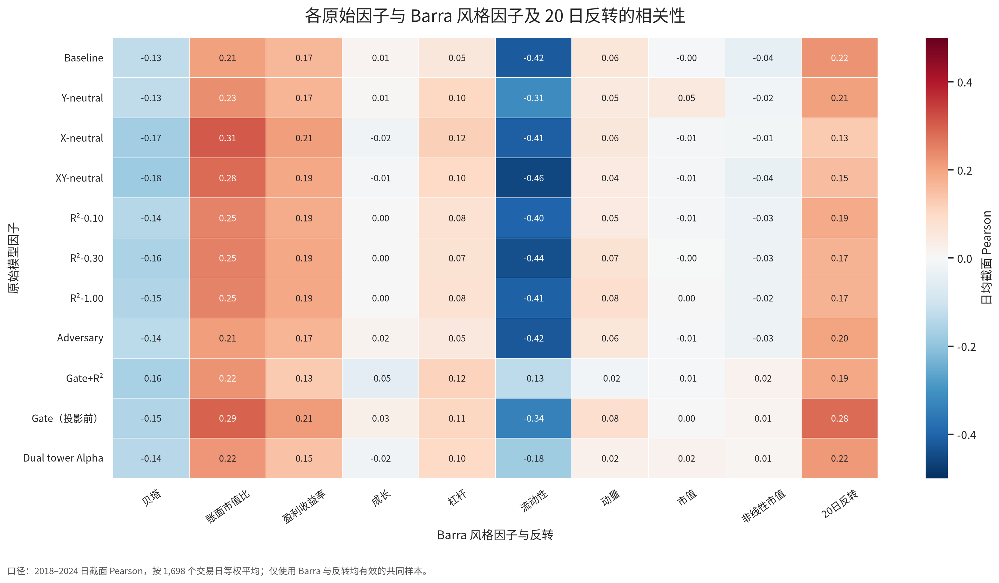
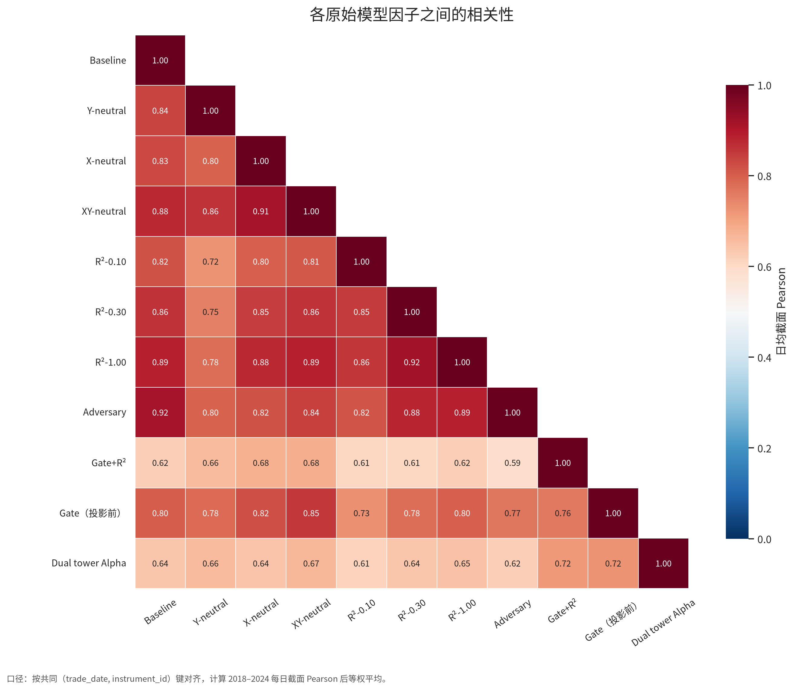

# ViViT：实验结果与结论

本文件是 No.0–No.6 样本外结果的唯一汇总。工程流程与关键函数见 [README.md](README.md)，各方案的数学原理、损失函数和梯度通道见 [Technical_report.md](Technical_report.md)。

## 1. 结果口径

所有已完成实验使用相同的 2018–2024 样本外区间、预测业务键、价格口径和 `mode2_t_no_filter` 评价模式。主要比较两类信号：

1. **原始输出**：模型直接发布或用于审计的投影前分数；
2. **统一 Barra 残差**：对各原始分数应用同一套“十个连续风险变量＋行业固定效应”事后中性化后的派生分数。

表中：

- 10D IC 为日截面 IC 的时间均值；
- Q5 超额年化以全市场等权组合为基准；
- 信息比使用日度主动收益和跟踪误差；
- 换手率为 Q5 相邻交易日成分的平均单边替换率；
- 最大超额回撤由 Q5 相对市场的日度主动收益净值计算；
- Barra 相关性先按日计算截面 Pearson，再对交易日等权平均。

No.5 需要单独区分分数口径：原始输出表使用投影前 `prediction_ensemble_unprojected`；统一残差表使用该列派生的 `gate_neutral_barra_residual`；正式发布列 `prediction_ensemble` 是训练图内严格投影分数。严格投影列已有暴露诊断，但尚未生成独立样本外回测，因此不把它与统一事后残差混写。

No.6 的正式主列等于 Alpha 塔：`prediction_ensemble == prediction_ensemble_alpha`。Style 与 Total 只作为分解诊断。

## 2. 实验覆盖

| No. | 方案 / Run | 当前状态 | 本文使用的原始分数 |
|---:|---|---|---|
| 0 | `baseline` | 已完成 | `prediction_ensemble` |
| 1 | `Y_neutral` | 已完成 | `prediction_ensemble` |
| 1 | `X_neutral` | 已完成 | `prediction_ensemble` |
| 1 | `XY_neutral` | 已完成 | `prediction_ensemble` |
| 2 | `penalty_r2_0p10` | 已完成 | `prediction_ensemble` |
| 2 | `penalty_r2_0p30` | 已完成 | `prediction_ensemble` |
| 2 | `penalty_r2_1p00` | 已完成 | `prediction_ensemble` |
| 3 | `adversary`，$\gamma_{\max}=0.10$ | 已完成 | `prediction_ensemble` |
| 4 | `gate_penal_0p3`，`real`，$\lambda=0.30$ | 已完成 | `prediction_ensemble` |
| 5 | `gate_neutral`，`real`，$\lambda=0$ | 已完成 | `prediction_ensemble_unprojected` |
| 6 | `dual_tower`，`real`，$\eta=\mu=1$，$\lambda=0.30$ | 已完成 | `prediction_ensemble_alpha` |

No.4–No.6 的汇总口径采用已完成的首轮 `real` 模式正式结果。

## 3. 原始输出的 Barra 暴露

联合 $R^2$ 为每日使用十个连续风险变量与行业固定效应解释原始分数得到的截面 $R^2$。最后一列先对每个风险变量计算日均 Pearson，再取最大绝对值。

| No. | 原始 Run | 日均联合 R² | 最大单日联合 R² | 最大绝对日均 Pearson |
|---:|---|---:|---:|---:|
| 0 | `baseline` | 0.3225 | 0.5425 | 0.4187 |
| 1 | `Y_neutral` | 0.2360 | 0.4515 | 0.3148 |
| 1 | `X_neutral` | 0.3261 | 0.4869 | 0.4108 |
| 1 | `XY_neutral` | 0.3459 | 0.5349 | 0.4552 |
| 2 | `penalty_r2_0p10` | 0.2977 | 0.5066 | 0.3985 |
| 2 | `penalty_r2_0p30` | 0.3460 | 0.5451 | 0.4378 |
| 2 | `penalty_r2_1p00` | 0.3347 | 0.5240 | 0.4079 |
| 3 | `adversary` | 0.3252 | 0.5378 | 0.4220 |
| 4 | `gate_penal_0p3` | 0.1869 | 0.5293 | 0.2242 |
| 5 | `gate_neutral`（投影前） | 0.3654 | 0.6438 | 0.3397 |
| 6 | `dual_tower`（Alpha） | 0.1619 | 0.3746 | 0.2196 |

双塔 Alpha 的日均联合 $R^2$ 和最大绝对日均 Pearson 都是当前最低；No.5 的严格投影正式分数接近数值正交，但其投影前分数暴露并不低，两者不能混为同一结论。

## 4. 原始因子的相关性结构

下图把上一表最后一列展开到九个 CNE5S 风格因子和 20 日反转。每个单元格使用 2018–2024 日截面 Pearson 的时间均值。Baseline 最显著的方向是流动性（-0.4187）；`Gate+R²` 将该相关性降至 -0.1308，双塔 Alpha 为 -0.1776。双塔 Alpha 的最大绝对相关性来自账面市值比（0.2196）。



各原始因子之间按共同 `(trade_date, instrument_id)` 键对齐。所有非对角相关性均为正，范围为 0.5925–0.9191，说明不同训练方案仍共享较强的基础排序信息。双塔 Alpha 与其他原始因子的相关性为 0.6148–0.7249，与 Baseline 为 0.6382；它更具差异性，但不能据此认定为独立因子。



两张图的日度明细、均值矩阵和绘图口径记录在 [`results_assets/correlation_manifest.json`](results_assets/correlation_manifest.json)。

## 5. 原始输出表现

| No. | 原始 Run | 10D IC | Q5 超额年化 | 信息比 | 换手率 | 最大回撤 | 最大超额回撤 |
|---:|---|---:|---:|---:|---:|---:|---:|
| 0 | `baseline` | 0.1171 | 25.76% | 3.97 | 22.55% | -26.09% | -6.76% |
| 1 | `Y_neutral` | 0.1090 | 24.92% | 3.74 | 25.64% | -28.40% | -9.57% |
| 1 | `X_neutral` | 0.1168 | 27.10% | 3.82 | 22.84% | -27.03% | -9.12% |
| 1 | `XY_neutral` | 0.1176 | 25.76% | 3.65 | 22.22% | -25.97% | -9.13% |
| 2 | `penalty_r2_0p10` | 0.1176 | 25.60% | 3.96 | 21.10% | -25.70% | -7.12% |
| 2 | `penalty_r2_0p30` | 0.1143 | 24.03% | 3.57 | 19.28% | -27.28% | -8.33% |
| 2 | `penalty_r2_1p00` | 0.1170 | 27.26% | 4.24 | 22.09% | -26.44% | -7.39% |
| 3 | `adversary` | 0.1173 | 26.73% | 4.00 | 19.82% | -26.11% | -7.74% |
| 4 | `gate_penal_0p3` | 0.1000 | 24.37% | 3.31 | 20.50% | -26.65% | -9.45% |
| 5 | `gate_neutral`（投影前） | 0.1124 | 24.45% | 3.48 | 18.77% | -26.43% | -6.67% |
| 6 | `dual_tower`（Alpha） | 0.1027 | 23.75% | 3.84 | 18.12% | -27.86% | -6.04% |

原始预测能力整体接近：多数视频模型 10D IC 位于 0.10–0.12。`penalty_r2_1p00` 的 Q5 超额年化和信息比最高；双塔 Alpha 的换手率最低、最大超额回撤最小，但 IC 和收益低于 Baseline。

## 6. 统一 Barra 中性化残差表现

| No. | Barra 残差 Run | 10D IC | Q5 超额年化 | 信息比 | 换手率 | 最大回撤 | 最大超额回撤 |
|---:|---|---:|---:|---:|---:|---:|---:|
| 0 | `baseline_barra_residual` | 0.0639 | 17.02% | 5.11 | 24.07% | -32.08% | -2.50% |
| 1 | `Y_neutral_barra_residual` | 0.0601 | 17.85% | 4.90 | 26.02% | -32.32% | -2.46% |
| 1 | `X_neutral_barra_residual` | 0.0794 | 23.60% | 7.51 | 24.81% | -30.99% | -1.69% |
| 1 | `XY_neutral_barra_residual` | 0.0760 | 21.12% | 7.00 | 23.83% | -31.98% | -1.68% |
| 2 | `penalty_r2_0p10_barra_residual` | 0.0642 | 16.39% | 5.31 | 24.78% | -32.15% | -5.60% |
| 2 | `penalty_r2_0p30_barra_residual` | 0.0701 | 19.01% | 6.47 | 22.59% | -31.61% | -1.71% |
| 2 | `penalty_r2_1p00_barra_residual` | 0.0757 | 21.29% | 7.33 | 24.37% | -32.13% | -1.28% |
| 3 | `adversary_barra_residual` | 0.0635 | 16.87% | 4.99 | 23.47% | -32.57% | -2.58% |
| 4 | `gate_penal_0p3_barra_residual` | 0.0765 | 20.13% | 6.54 | 23.01% | -31.08% | -1.79% |
| 5 | `gate_neutral_barra_residual` | 0.0775 | 21.48% | 6.70 | 21.95% | -29.20% | -2.24% |
| 6 | `dual_tower_barra_residual` | 0.0697 | 18.98% | 6.08 | 20.28% | -32.98% | -1.83% |

`X_neutral` 是当前统一残差基准：10D IC、Q5 超额年化和信息比均为最高。`penalty_r2_1p00` 的最大超额回撤最小；双塔残差换手较低，但预测和收益指标没有超过 `X_neutral`。

## 7. 结论分析

### 7.1 标签或分数中性化

- `Y_neutral` 在 No.1 三个变体中的原始暴露最低，但原始与残差表现都未超过 Baseline。标签残差化可能同时剥离了部分可预测的风格收益，而原始输出没有硬约束，因此标签中性不等于分数中性。
- `X_neutral` 和 `XY_neutral` 没有降低投影前暴露，却显著改善统一残差表现。其损失主要识别风险正交补空间内的排序，对投影前风险列空间分量缺少约束；`X_neutral` 因而可以成为残差基准，但不能被描述为原始输出中性。

### 7.2 软约束与表征约束

- No.2 的样本外暴露没有随 $\lambda$ 单调下降。联合 $R^2$ 正则与 RankIC 目标存在竞争，而且 checkpoint 仍按验证 RankIC 选择；惩罚强度改变训练路径，不保证最终样本外暴露单调。
- No.3 基本保留 Baseline 的原始 IC 与收益，并把换手从 22.55% 降到 19.82%，但暴露和残差表现没有改善。GRL 约束隐藏表征对指定辅助头的可恢复性，并不直接约束收益头输出。

### 7.3 Barra 条件输入与输出约束

- No.4 将日均联合 $R^2$ 从 0.3225 降至 0.1869，并把统一残差 10D IC 从 0.0639 提升到 0.0765；代价是原始 10D IC 降至 0.1000。由于标签、门控和正则同时变化，现有结果尚不能识别主要贡献来源。
- No.5 证明训练图内硬投影能够使正式发布分数在数值精度内正交，但投影前日均联合 $R^2$ 为 0.3654。硬投影解决的是交付约束，不代表模型自然学出低暴露原始分数。其统一残差表现接近但未超过 `X_neutral`。
- No.6 双塔 Alpha 的原始暴露最低，换手也最低，但原始 10D IC 降至 0.1027；统一残差 10D IC 为 0.0697，仍低于 `X_neutral`。首轮结果支持“降低原始风格暴露并保留大部分收益”，尚不支持“Alpha/Style 分工提升了风险外预测力”。

### 7.4 综合判断

当前不存在一个方案同时在原始暴露、原始收益和统一残差预测力上全面占优：

- 若目标是最低的投影前 Barra 暴露，当前领先者是双塔 Alpha；
- 若目标是统一风险正交补空间内的预测力，当前领先者是 `X_neutral`；
- 若目标是正式发布信号的线性中性保证，No.5 的硬投影提供最明确约束；
- 若目标是原始 Q5 超额收益和信息比，`penalty_r2_1p00` 当前最好。

因此方案选择应明确交付目标，不能把“原始输出低暴露”“统一残差更强”和“正式信号严格中性”合并成单一排名。

## 8. 结果解释边界

1. No.4–No.6 的现有对比同时包含输入、标签、架构或损失变化，因此结果用于比较完整方案，不能把差异唯一归因于 Barra 条件信息。
2. No.5 严格投影正式列未纳入独立收益回测；本文对该列只作暴露约束判断，不以投影前分数的收益代替正式列表现。
3. 表中组合收益没有把换手进一步折算为交易成本后的净收益。
4. 多方案使用相同样本外区间进行比较，结论以全期结果、逐年稳定性和多 seed 离散度的现有证据为边界。

## 9. 结果产物

每个 run 的主要证据位于：

```text
data/quality/runs/<run_name>/
├── EXPERIMENT_REPORT*.md
├── vivit_training_summary.parquet
├── factor_evaluation/
├── barra_neutralization/
└── style_neutral_training/
```

相关性图与其日度明细位于 [`results_assets`](results_assets/correlation_manifest.json)。本文件只维护跨方案汇总，不重复工程函数索引或方案推导。
